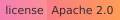
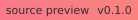
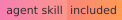
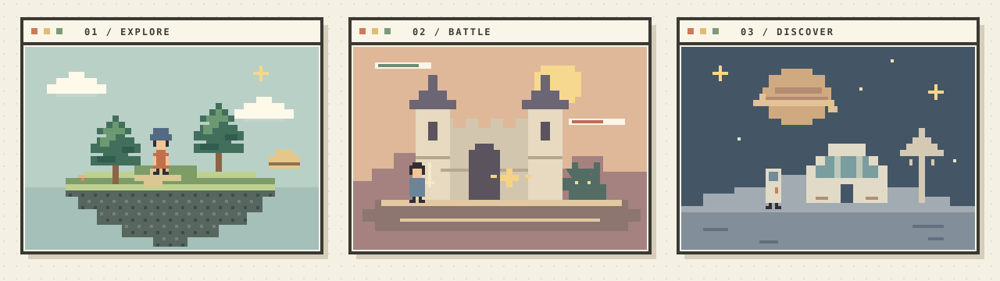
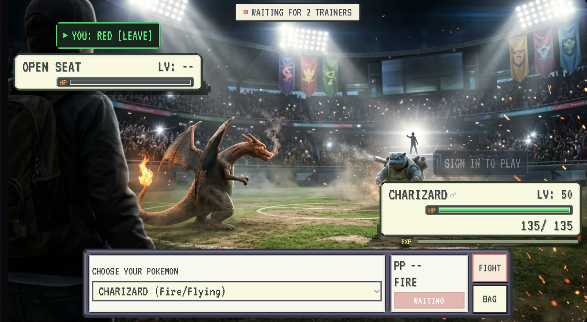

# Create infinite experiences, in minutes.

[](https://github.com/sequencer-media/genesis/actions/workflows/ci.yml)
[](LICENSE)
[](docs/compatibility.md)
[](docs/getting-started.md)
[](docs/api.md)
[](skills/create-world-stream/SKILL.md)

Give your World Model a memory, an inventory and a playable interface. GENESIS is the dungeon master for your worldstream: it remembers the world, applies the rules and connects player actions to generated scenes.

Open source, licensed under [Apache 2.0](LICENSE).

[Website](https://sequencer.media/genesis) · [Demos](https://sequencer.media/genesis/demos) · [Skill quickstart](https://sequencer.media/genesis/agent-skill) · [Documentation](https://sequencer.media/genesis/getting-started)

[Watch the demos](#what-is-a-worldstream) · [What can you build?](#what-can-you-build) · [Build from a prompt](#one-prompt-an-infinite-experience) · [Documentation](docs/getting-started.md) · [SDK API](docs/api.md) · [Connect your models](#connect-your-own-world-models) · [Worldstreams API](#worldstreams-api-instant-setup)



## Your World Model needs an Engine.

In a tabletop game, the dungeon master remembers what you carry, who you met and what changed. GENESIS gives infinite experiences that same foundation.

<div id="worldstreams-in-action"></div>

## What is a Worldstream?

A Worldstream is a generated video experience you can watch and interact with. Player actions shape what happens next.

### Rick and Morty · Multiplayer Worldstream

Two players direct Rick and Morty through their own character controls. Both actions feed the shared Worldstream. Click the image to watch the multiplayer recording.

[](https://sequencer.media/demo/worlds/multiplayer-demo-cropped-v2.mp4)

[Watch multiplayer video](https://sequencer.media/demo/worlds/multiplayer-demo-cropped-v2.mp4) · [Explore the demos](docs/demos.md)

| Adventure Time · Land of Ooo | World Model games |
| --- | --- |
| [](https://sequencer.media/demo/worldstreams/adventure-time/adventure-time-720p-0bfe8c425454.mp4) | [](https://sequencer.media/landing/product-demos/world-games-v03-720p.mp4) |
| A connected fantasy journey with audience-choice controls. [Watch video](https://sequencer.media/demo/worldstreams/adventure-time/adventure-time-720p-0bfe8c425454.mp4) · [Try the preview](https://sequencer.media/demo/worldstreams/adventure-time) | Explore the visual presentation of World Model game experiences. [Watch video](https://sequencer.media/landing/product-demos/world-games-v03-720p.mp4) |

These are recorded Worldstreams examples. Preview choices illustrate the interaction flow around prepared World Model output. Live generation uses a connected provider. Read the [SDK reference](docs/api.md) and [world-building skill guide](docs/agent-skill.md), or run `npm run docs:dev` to open the searchable documentation site and video gallery locally.

## How GENESIS works

The GENESIS Context Engine combines character memory, scenes, inventory, multiplayer rules and world settings into model context. An external LLM creates prompts and structured replies, and the World Model generates the next scene. Streaming delivery brings the video back to your interactive UI.


**Visual Context** is an optional part of the GENESIS Context Engine. World settings and LLM prompts guide its starting or reference images, which connect directly to the World Model alongside text context.

Connect the modules your experience needs. GENESIS defines the contract for world state, player actions and model requests. LLMs, World Models and streaming delivery use replaceable adapters; your host supplies their credentials and infrastructure. [Explore the architecture](docs/architecture.md).

## What can you build?

Build worlds people can play, watch, explore, learn from and shape together.

| Experience | Imagine your worldstream |
| --- | --- |
| **Games** | Roleplaying adventures, puzzles, quests and battles that remember each choice. |
| **Multiplayer games** | Cooperative journeys, competitive arenas and shared worlds with individual player controls. |
| **Infinite TV** | Ongoing shows with recurring characters, evolving storylines and audience-directed plots. |
| **Learning experiences** | Explore science, practice languages and solve problems inside interactive worlds. |
| **Travel experiences** | Wander cities, landmarks and imagined destinations, choosing where to go next. |
| **Interactive history lessons** | Step into another era, meet its characters and explore how decisions shape events. |
| **Robotics training simulations** | Connect simulation tools to rehearse navigation, object interactions and changing environments. |
| **Therapy and wellbeing** | Practitioner-led roleplay, guided reflection and calming environments. |
| **Coaching** | Rehearse interviews, leadership and public speaking with scenarios that remember progress. |
| **Training and rehearsal** | Practice customer service, workplace scenarios and complex decisions in guided simulations. |
| **Interactive stories** | Branching mysteries, character relationships and adventures shaped by the audience. |
| **Social worlds** | Shared hangouts, community characters and places that grow with their participants. |
| **Creative sandboxes** | Design spaces, invent characters and direct scenes inside a world you can keep changing. |
| **Live events** | Audience-led performances, collective challenges and interactive broadcasts. |
| **Virtual showrooms** | Explore products, interiors and spaces through guided tours and custom interactions. |

These are directions for your next experience. You supply the domain content and rules, then connect the models or specialist tools it needs.

## What GENESIS handles

Pick up a key, and it stays in your inventory. Unlock a door, and that location changes. Meet a character, and your controller can remember the relationship. The next scene receives that context, and every player sees the accepted result.

| GENESIS handles | Your world remembers |
| --- | --- |
| **Context Engine** | Assemble memory, world settings and accepted actions into context for connected models. |
| **World memory** | Progress, previous choices and persistent public, private and server state. |
| **Inventory and variables** | Items, health, scores, resources, quest flags and the values your rules depend on. |
| **Scenes, locations and characters** | Define places, characters, relationships and scene facts in structured state, then carry them into generation requests. |
| **LLM orchestration and prompts** | Supply world context and committed outcomes; validate structured replies for new moves, dialogue and choices. |
| **Visual Context** | Optionally create starting or reference images from world settings and LLM prompts, then supply image context directly to a compatible World Model. |
| **Playable interfaces** | Custom controls, inventory panels, overlays and animations in HTML, CSS and JavaScript. |
| **Shared rules and multiplayer** | Authoritative turns, player seats, crowd votes and validated actions. |
| **Generation and scene continuity** | Track jobs, reject stale results, carry the actual end frame forward and reopen actions after playback. |
| **Portable worlds and media** | Export the world's source and declared images, audio and video as one bundle. |

You define the world and its rules. GENESIS runs the state and interaction loop; connected World Models and LLMs generate the media and structured responses.

## One prompt. An infinite experience.

The bundled [create-world-stream agent skill](skills/create-world-stream/SKILL.md) turns an idea into world settings, a custom interface, controller rules and a portable project. Follow the [skill quickstart](docs/agent-skill.md) to set up Genesis, describe your world and play the result.

Give a coding agent this checkout and a prompt:

```text
Use the create-world-stream skill to build Mosslight, a forest battle
worldstream with a cream pixel interface. Let two players take turns
and have the backend LLM create four moves for each encounter.
Remember their inventory, health and progress. Give me a working
local preview and an exportable world.
```

The skill wires backend requests, declares assets, validates the bundle and exercises the player flow. [AGENTS.md](AGENTS.md) points repo-aware agents to it; other skill-capable agents can load its SKILL.md directly.

Start with labeled local fixtures. With a configured provider and budget, the agent can create and attach images, audio and video for your worldstream.

## Play your first world

Requires Node 20 or later. Clone the repository and run:

```sh
git clone https://github.com/sequencer-media/genesis.git
cd genesis
npm ci
npm run build
node dist/cli.js init ./my-world --template arena-llm
node dist/cli.js dev ./my-world
```

Open the printed local URL. Play the vintage pixel battle, switch preview players and take a turn. The starter uses four structured move definitions, shared health and authoritative turns. Local moves and video use prepared fixtures; a connected Worldstreams host requests real backend LLM results.

| Starter | Create your experience |
| --- | --- |
| `arena-llm` | A vintage battle with LLM-created moves and shared player seats. |
| `exploration` | An evolving world where each completed scene becomes the next starting point. |
| `decisions` | Branching choices and collective decisions. |
| `timing` | A challenge with a defined input window and repeatable starting scene. |
| `arena` | A battle with fixed server-resolved moves, inventory and spectator queues. |

Choose another starter with `--template`. Edit the project files, then restart the runner. Sessions pin their project version; remove the generated `.genesis/` directory inside your world to start a fresh development session after code changes.

<details>
<summary>See the vintage arena on mobile</summary>


</details>

## Three files. Your whole world.

```text
my-world/
├── genesis.json      World settings, actions, tools and asset registry
├── interface.html    Your interface, controls and browser behavior
├── controller.js     World memory, shared rules and backend requests
└── assets/           Images, audio and video that travel with the project
```

The interface sends actions and renders accepted state. The controller updates inventory, variables, characters and locations according to your rules, then requests the next scene. The host supplies identity, credentials, storage and spending policy.

```sh
node dist/cli.js validate ./my-world
node dist/cli.js export ./my-world --out ./my-world.zip
```

The ZIP includes the three entry files, the JSON Schema and complete declared assets. Safe relative paths make media portable; hosting adapters copy assets and provide runtime URLs. Keep provider keys, wallets and commercial settings in the host. [Read the project boundary](docs/project-boundary.md).

## Development preview

Version 0.1 is an Apache 2.0 licensed source preview. Clone the repository to build and run it locally. npm publication and the wider launch are being prepared.

```sh
npm test
npm run docs:build
npm pack --dry-run
```

<details>
<summary>Current runtime and provider limits</summary>

The standalone preview verifies bounded clips, prepared media and structured tool data. Continuous worldstreams and avatar/audio sessions require a deployment-specific presentation adapter. The Replicate adapter has protocol-fixture coverage; live paid predictions still need validation. Current reference limits include 100 participants, 32 actions, 200 KB session state and 2–10 second clips.

Portable continuous-stream settings accept 2–30 second chunk intervals. The current Worldstreams deployment accepts 14 seconds, with approximately 14.375 seconds of provider output. Hosts validate supported intervals.

Private Worldstreams API sessions currently support 30–600 seconds and cost $40/hour of active streaming. The API quotes and reserves the maximum cost, then refunds unused credit on teardown. Startup is excluded. Viva includes built-in LLM direction; custom structured LLM requests and extra assets are priced separately. Always use the returned quote.

See [compatibility](docs/compatibility.md) and [integration](docs/integration.md) for versioning, stream leases and release checks.

</details>

## Example projects

[](https://sequencer.media/worldstreams/S_R5xijO8Pjv)

[**Pokémon Stadium**](https://sequencer.media/worldstreams/S_R5xijO8Pjv) brings two trainers into a shared battle Worldstream, with Pokémon selection, turns, type effects, status conditions, items, EXP and a challenger queue. [Explore the project](https://sequencer.media/genesis/examples).

## Connect your own World Models

GENESIS works with the providers you choose. Keep your LLM and World Model adapters separate so either can evolve independently.

1. **Connect your LLM.** Use `createLlmProvider` with a server-side `generate(request, context)` callback. Map the prompt, world context, response schema and budget to your provider's API. GENESIS validates the returned data before sending it to the controller.
2. **Connect your World Model.** Implement the [provider contract](docs/providers.md) for submission, status and cancellation. Persist generated media and supply the video's actual end-frame checkpoint. The SDK includes prepared-media and Replicate adapters.
3. **Connect your app.** Run `GenesisHost` on your server and `mountGenesisPlayer` in the browser, joined by authenticated routes. Your host controls identity, credentials, permissions and billing.

Use durable result storage for paid requests. Memory and atomic file adapters support one host process; distributed deployments need transactional storage, admission control and durable scheduling. Live worldstreams also need readiness, prompt delivery, playback acknowledgments, reconnects and viewer revocation. [Read the API](docs/api.md), [architecture](docs/architecture.md) and [host authority](docs/host-authority.md).

## Worldstreams API: instant setup

Use the included Sequencer integration to connect the [Worldstreams](https://worldstreams.ai) API. One server-side `SEQUENCER_API_KEY` connects LLM tools, World Model streams, image/audio/video generation, assets and versioned world drafts.

Set your key in the server environment, choose your workspace and save the project:

```sh
export SEQUENCER_API_KEY="YOUR_SERVER_API_KEY"
node dist/cli.js save ./my-world --workspace YOUR_WORKSPACE_ID
```

The command uploads the declared assets and returns a saved draft and preview URL. Use `SequencerClient` to discover models, quote generation and control a private worldstream. `createSequencerLlmProvider` connects structured LLM tools to the same account. [Follow the integration guide](docs/integration.md).

| Requirement | Your own stack (BYO) | Your app + Sequencer API | Sequencer hosted |
| --- | --- | --- | --- |
| World memory, rules and custom UI | GENESIS | GENESIS | GENESIS in the world editor |
| App hosting, database and world workers | You provide | Your app infrastructure, managed model services | Sequencer provides |
| Audience authentication | You provide | You provide; server key authenticates API calls | Sequencer accounts |
| World Model and video delivery | Choose provider and integration | Managed Worldstreams API | Managed model, player and rooms |
| LLM, image and audio APIs | Choose providers | Same Sequencer key, metered usage | Built-in tools, metered usage |
| Assets and world drafts | Choose storage | Sequencer workspace assets | Workspace media library |
| Audience billing | You build | You manage; your account pays API usage | Gems and shared viewer billing |
| Publishing, chat and voting UI | You build | Your app's audience experience | Sequencer provides |
| Price | Free engine; provider and infrastructure costs | Viva $40/hour; other models priced per route | Viva cost shared in gems; paid actions can cost extra |

Viva includes built-in LLM direction. Custom structured calls and extra media have separate usage charges. [Compare World Models and low-latency LLMs](https://sequencer.media/genesis/models), including prices, response timing and moderation controls. Planned routes have estimated prices; live quotes determine billing.

## Build with us

Found an issue or have an idea? [Open an issue](https://github.com/sequencer-media/genesis/issues). Read the [contribution guide](CONTRIBUTING.md) before making a pull request. If GENESIS is useful to you, star the repository and share what you build.

[Contributing](CONTRIBUTING.md) · [Security](SECURITY.md) · [Apache 2.0 license](LICENSE) · [Sequencer](https://sequencer.media) · [Worldstreams](https://worldstreams.ai)
