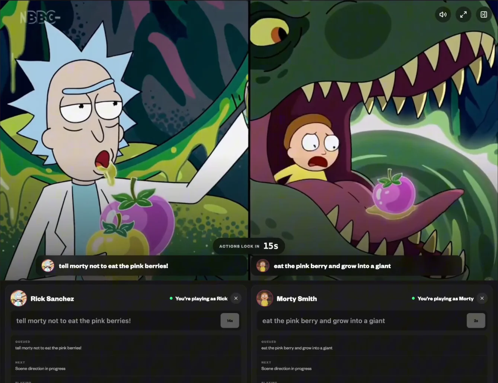
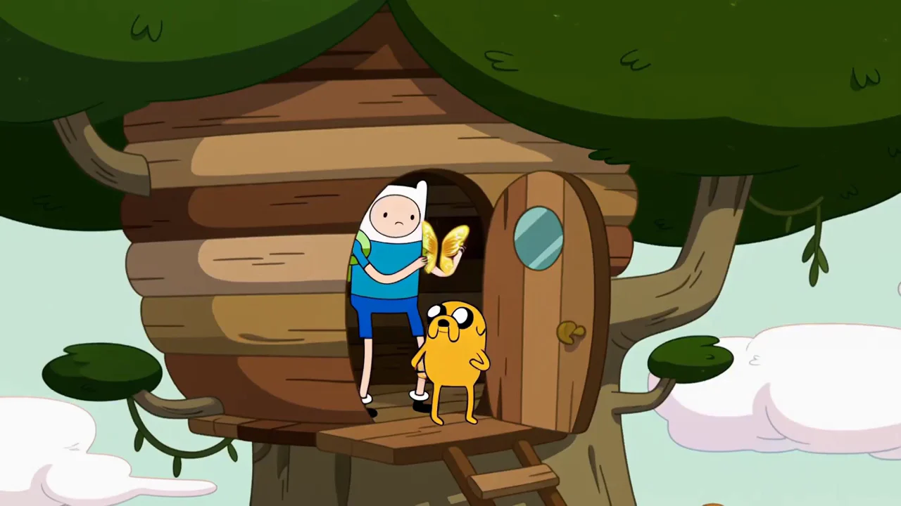
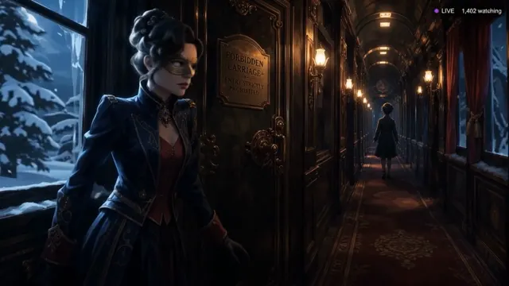
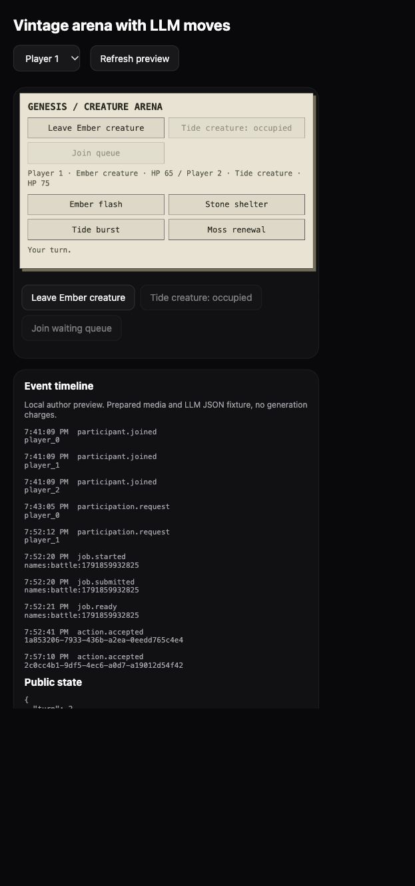

```text
  _____ ______ _   _ ______  _____ _____  _____
 / ____|  ____| \ | |  ____|/ ____|_   _|/ ____|
| |  __| |__  |  \| | |__  | (___   | | | (___
| | |_ |  __| | . \ |  __|  \___ \  | |  \___ \
| |__| | |____| |\  | |____ ____) |_| |_ ____) |
 \_____|______|_| \_|______|_____/|_____|_____/
```

# GENESIS · Open Source World Model Game Engine

**Create infinite experiences, in minutes.**

Give your World Model a memory, an inventory and a playable interface.

GENESIS is an open source SDK for building worldstreams: evolving experiences where player actions, shared rules and generated scenes move together. Describe your world to a coding agent, play the local prototype, then connect your World Model.

[Documentation](docs/index.html) · [Watch the demos](#worldstreams-in-action) · [Build from a prompt](#one-prompt-an-infinite-experience) · [Start locally](#play-your-first-world) · [Connect your models](#connect-your-own-world-models) · [Worldstreams API](#worldstreams-api-instant-setup)

## Your World Model needs a dungeon master.

In a tabletop roleplaying game, the dungeon master remembers your inventory, knows the characters and locations, applies the rules and describes what happens next. An infinite experience needs the same foundation.

GENESIS fills that role for your World Model. It keeps the world in structured state, resolves player actions and passes the committed outcome to the LLM and scene generator. Your interface reflects the same shared reality.

Pick up a key, and it stays in your inventory. Unlock a door, and that location changes. Meet a character, and your controller can remember the relationship. The next scene receives that context, and every player sees the accepted result.

| GENESIS handles | Your world remembers |
| --- | --- |
| **World memory** | Progress, previous choices and persistent public, private and server state. |
| **Inventory and variables** | Items, health, scores, resources, quest flags and the values your rules depend on. |
| **Scenes, locations and characters** | Define places, characters, relationships and scene facts in structured state, then carry them into generation requests. |
| **LLM orchestration and prompts** | Supply world context and committed outcomes; validate structured replies for new moves, dialogue and choices. |
| **Playable interfaces** | Custom controls, inventory panels, overlays and animations in HTML, CSS and JavaScript. |
| **Shared rules and multiplayer** | Authoritative turns, player seats, crowd votes and validated actions. |
| **Generation and scene continuity** | Track jobs, reject stale results, carry the actual end frame forward and reopen actions after playback. |
| **Portable worlds and media** | Export the world's source and declared images, audio and video as one bundle. |

You define the world and its rules. GENESIS runs the state and interaction loop; connected World Models and LLMs generate the media and structured responses.

## Worldstreams in action

### Rick and Morty · Multiplayer Worldstream

Two players direct Rick and Morty through their own character controls. Both actions feed the shared Worldstream. Click the image to watch the multiplayer recording.

[](https://sequencer.media/demo/worlds/multiplayer-demo-cropped-v2.mp4)

[Watch multiplayer video](https://sequencer.media/demo/worlds/multiplayer-demo-cropped-v2.mp4) · [Explore the demos](docs/demos.html)

| Adventure Time · Land of Ooo | World Model games |
| --- | --- |
| [](https://sequencer.media/demo/worldstreams/adventure-time/adventure-time-720p-0bfe8c425454.mp4) | [](https://sequencer.media/landing/product-demos/world-games-v03-720p.mp4) |
| A connected fantasy journey with audience-choice controls. [Watch video](https://sequencer.media/demo/worldstreams/adventure-time/adventure-time-720p-0bfe8c425454.mp4) · [Try the preview](https://sequencer.media/demo/worldstreams/adventure-time) | Explore the visual presentation of World Model game experiences. [Watch video](https://sequencer.media/landing/product-demos/world-games-v03-720p.mp4) |

These are recorded examples. Preview choices illustrate the interaction flow around prepared World Model output. Live generation uses a connected provider. The [demo and documentation site](docs/index.html) includes playable videos, the full SDK reference and the [world-building skill guide](docs/agent-skill.html).

## One prompt. An infinite experience.

The bundled [create-world-stream agent skill](skills/create-world-stream/SKILL.md) turns an idea into world settings, a custom interface, controller rules and a portable project.

Give a coding agent this checkout and a prompt:

```text
Use the create-world-stream skill to build Mosslight, a forest battle
worldstream with a cream pixel interface. Let two players take turns
and have the backend LLM create four moves for each encounter.
Remember their inventory, health and progress. Give me a working
local preview and an exportable world.
```

The skill wires backend requests, declares assets, validates the bundle and exercises the player flow. [AGENTS.md](AGENTS.md) points repo-aware agents to it; other skill-capable agents can load its SKILL.md directly.

Start with labeled local fixtures. With a configured provider and budget, the agent can create and attach images, audio and video for your worldstream.

## Play your first world

Requires Node 20 or later. From this source checkout:

```sh
npm ci
npm run build
node dist/cli.js init ./my-world --template arena-llm
node dist/cli.js dev ./my-world
```

Open the printed local URL. Play the vintage pixel battle, switch preview players and take a turn. The starter uses four structured move definitions, shared health and authoritative turns. Local moves and video use prepared fixtures; a connected Worldstreams host requests real backend LLM results.

| Starter | Create your experience |
| --- | --- |
| `arena-llm` | A vintage battle with LLM-created moves and shared player seats. |
| `exploration` | An evolving world where each completed scene becomes the next starting point. |
| `decisions` | Branching choices and collective decisions. |
| `timing` | A challenge with a defined input window and repeatable starting scene. |
| `arena` | A battle with fixed server-resolved moves, inventory and spectator queues. |

Choose another starter with `--template`. Edit the project files, then restart the runner. Sessions pin their project version; remove the generated `.genesis/` directory inside your world to start a fresh development session after code changes.

<details>
<summary>See the vintage arena on mobile</summary>



</details>

## Three files. Your whole world.

```text
my-world/
├── genesis.json      World settings, actions, tools and asset registry
├── interface.html    Your interface, controls and browser behavior
├── controller.js     World memory, shared rules and backend requests
└── assets/           Images, audio and video that travel with the project
```

The interface sends actions and renders accepted state. The controller updates inventory, variables, characters and locations according to your rules, then requests the next scene. The host supplies identity, credentials, storage and spending policy.

```sh
node dist/cli.js validate ./my-world
node dist/cli.js export ./my-world --out ./my-world.zip
```

The ZIP includes the three entry files, the JSON Schema and complete declared assets. Safe relative paths make media portable; hosting adapters copy assets and provide runtime URLs. Keep provider keys, wallets and commercial settings in the host. [Read the project boundary](docs/project-boundary.md).

## Development preview

Version 0.1 is an unpublished development preview, licensed under Apache 2.0. This repository is being polished for launch.

```sh
npm test
npm run docs:build
npm pack --dry-run
```

<details>
<summary>Current runtime and provider limits</summary>

The standalone preview verifies bounded clips, prepared media and structured tool data. Continuous worldstreams and avatar/audio sessions require a deployment-specific presentation adapter. The Replicate adapter has protocol-fixture coverage; live paid predictions still need validation. Current reference limits include 100 participants, 32 actions, 200 KB session state and 2–10 second clips.

Portable continuous-stream settings accept 2–30 second chunk intervals. The current Worldstreams deployment accepts 14 seconds, with approximately 14.375 seconds of provider output. Hosts validate supported intervals.

Private Worldstreams API sessions currently support 30–600 seconds and cost $40/hour of active streaming. The API quotes and reserves the maximum cost, then refunds unused credit on teardown. Startup is excluded; generation and LLM requests are priced separately. Always use the returned quote.

See [compatibility](docs/compatibility.md), [integration](docs/integration.md) and [launch preparation](docs/launch.md) for versioning, stream leases and release checks.

</details>

## Connect your own World Models

GENESIS works with the providers you choose. Keep your LLM and World Model adapters separate so either can evolve independently.

1. **Connect your LLM.** Use `createLlmProvider` with a server-side `generate(request, context)` callback. Map the prompt, world context, response schema and budget to your provider's API. GENESIS validates the returned data before sending it to the controller.
2. **Connect your World Model.** Implement the [provider contract](docs/providers.md) for submission, status and cancellation. Persist generated media and supply the video's actual end-frame checkpoint. The SDK includes prepared-media and Replicate adapters.
3. **Connect your app.** Run `GenesisHost` on your server and `mountGenesisPlayer` in the browser, joined by authenticated routes. Your host controls identity, credentials, permissions and billing.

Use durable result storage for paid requests. Memory and atomic file adapters support one host process; distributed deployments need transactional storage, admission control and durable scheduling. Live worldstreams also need readiness, prompt delivery, playback acknowledgments, reconnects and viewer revocation. [Read the API](docs/api.md), [architecture](docs/architecture.md) and [host authority](docs/host-authority.md).

## Worldstreams API: instant setup

Use the included Sequencer integration to connect the [Worldstreams](https://worldstreams.ai) API. One server-side `SEQUENCER_API_KEY` connects LLM tools, World Model streams, image/audio/video generation, assets and versioned world drafts.

Set your key in the server environment, choose your workspace and save the project:

```sh
export SEQUENCER_API_KEY="YOUR_SERVER_API_KEY"
node dist/cli.js save ./my-world --workspace YOUR_WORKSPACE_ID
```

The command uploads the declared assets and returns a saved draft and preview URL. Use `SequencerClient` to discover models, quote generation and control a private worldstream. `createSequencerLlmProvider` connects structured LLM tools to the same account. [Follow the integration guide](docs/integration.md).

| Capability | GENESIS + Worldstreams API | GENESIS + your own models |
| --- | --- | --- |
| World memory, rules, custom UI and portable bundles | Included | Included |
| LLM, images, audio, video and World Model stream APIs | One Sequencer server key | Connect adapters and credentials |
| Assets and versioned world drafts | Managed integration | Choose storage and publishing |
| Shared backend job polling | Managed by Worldstreams hosting | Run your worker |
| Hosted viewer identity and billing | Worldstreams accounts, gems and viewer leases | Implement your policies |
| Audience and monetization in your own app | Yours to manage | Yours to manage |

[Contributing](CONTRIBUTING.md) · [Security](SECURITY.md) · [Apache 2.0 license](LICENSE)
