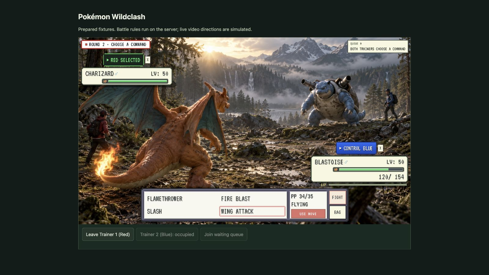

# Example projects

Explore GENESIS worlds with real interfaces, shared rules and persistent state.

## Mosslight: Lantern Run

Run `npm run play` for a complete solo adventure. Find three stars, choose a route, manage your lantern and outwit a thorn sentinel. A run takes six or more choices and ends with a result you can replay. Everything runs locally without an account, API key or model provider.

The [`quest` starter](https://github.com/sequencer-media/genesis/tree/main/examples/quest) includes the interface, authoritative rules and editable settings. Change the world name, lantern duration or difficulty in `genesis.json`, then restart the preview. [Start playing and remixing](getting-started.md).

## Pokémon Wildclash

[Open Pokémon Wildclash on Sequencer](https://sequencer.media/worldstreams/S_R5xijO8Pjv) or [browse the complete project source](https://github.com/sequencer-media/genesis/tree/main/examples/pokemon-wildclash).

This is the current Pokémon Worldstream project, including its actual controller, trainer interface, visual settings and bundled start artwork. Two trainers send out their chosen Pokémon and privately commit a move or item each round. Priority and Speed determine order. A challenger queue lets the next trainer join the action.

[](https://sequencer.media/worldstreams/S_R5xijO8Pjv)

| Part of the experience | What it demonstrates |
| --- | --- |
| Trainer selection and readiness | Player seats, eligible actions and a shared start condition. |
| Private command rounds | Authoritative priority, Speed, type effects, status, PP and battle outcomes. |
| Items, health and EXP | World variables that persist between actions. |
| Challenger queue | Multiplayer participation and room state. |
| Battle interface and Worldstream | Player controls around generated video. |
| Background frame library | Prepare lineup and aftermath checkpoints ahead of events, then reanchor after observed playback. |
| PLAY BOTH | One account can control two trainers for testing. |

### Play the included project

```sh
npm run build
node dist/cli.js dev examples/pokemon-wildclash
```

Open the printed URL, choose a trainer or PLAY BOTH, then choose a Pokémon and press SEND OUT. The local preview runs the real rules and simulates continuous video directions with prepared fixtures. It makes no model requests.

For separate browser connections with authenticated players and persistent shared state:

```sh
npm run serve:world
```

Open the server URL in two windows and use a different printed player token in each. The [server guide](hosting.md) explains provider configuration and deployment. A live continuous World Model requires its stream and presentation adapter.

### Remix the project

Edit the project's three entry files to change its cast, rules or visual style. Use the [Genesis skill quickstart](agent-skill.md) for an original world. The `arena-llm` starter demonstrates bounded generated move sets, and `arena` provides simpler fixed combat.

Keep accepted game outcomes in `controller.js`. Use generated video to depict the committed outcome and advance the visual turn after playback completes. [Read the authoring contract](../AGENTS.md).

Publish your finished world using [My Worlds](https://sequencer.media/worldstreams#my-worlds), or export a complete project for your own host.

## Included starter projects

The repository includes runnable starters for solo adventures, exploration, battles, crowd voting, shared state and custom tools. [Run a starter locally](getting-started.md) or [watch the Worldstream demos](demos.md).
