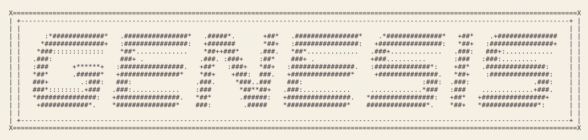
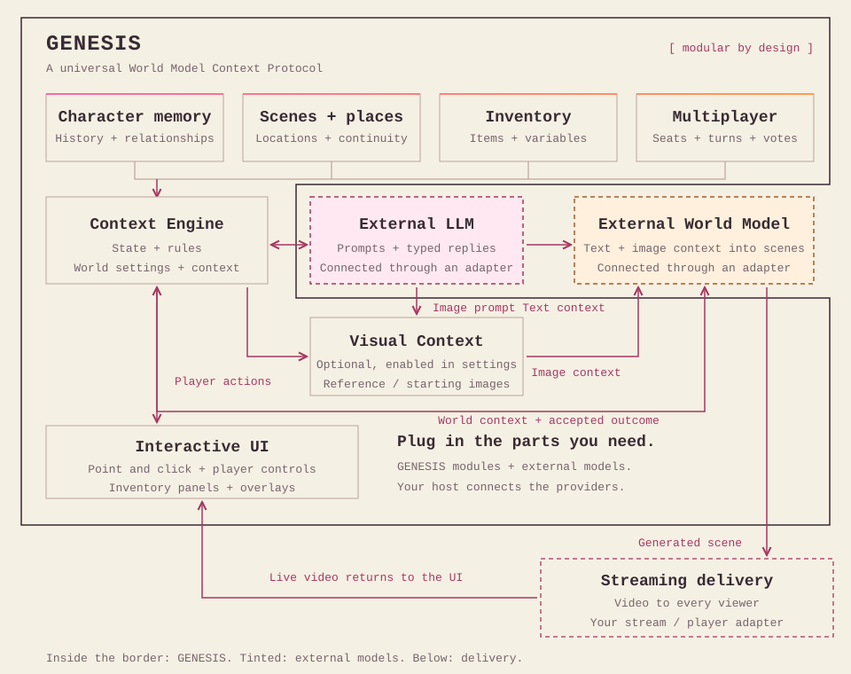

<section class="hero">

<div>

# World Model Engine

<p class="hero-tagline">Create infinite experiences, in minutes.</p>

**A universal World Model Context Protocol.**

## Your World Model needs an engine.

GENESIS gives generated worlds memory, rules and controls. It tracks your inventory, characters and locations, then connects each player action to what happens next.

<nav class="hero-actions" aria-label="Start exploring"><a href="#worldstreams-in-action">Watch the demos</a><a href="#quickstart-with-the-genesis-skill">Build your first world</a></nav>
<p class="hero-note">Run locally with the included examples. Connect your models when you're ready.</p>
</div>
</section>

## Worldstreams in action

Rick and Morty have their own character controls, and both actions feed the shared experience. Watch the multiplayer Worldstream.

<figure class="demo-feature">
<video controls playsinline preload="none" poster="assets/rick-morty-multiplayer.webp" aria-label="Rick and Morty multiplayer Worldstream">
<source src="https://sequencer.media/demo/worlds/multiplayer-demo-cropped-v2.mp4" type="video/mp4">
<a href="https://sequencer.media/demo/worlds/multiplayer-demo-cropped-v2.mp4">Watch the multiplayer Rick and Morty video</a>
</video>
<figcaption>Recorded Worldstreams example. <a href="demos.html">Explore all demos</a>.</figcaption>
</figure>

<div class="demo-gallery">
<section class="demo-card">
<video controls playsinline preload="none" poster="assets/adventure-time-worldstream.webp" aria-label="Adventure Time Worldstream, Land of Ooo">
<source src="https://sequencer.media/demo/worldstreams/adventure-time/adventure-time-720p-0bfe8c425454.mp4" type="video/mp4">
<a href="https://sequencer.media/demo/worldstreams/adventure-time/adventure-time-720p-0bfe8c425454.mp4">Watch the Adventure Time video</a>
</video>
<div class="demo-caption"><h3>Adventure Time · Land of Ooo</h3><p>A fantasy journey with audience-choice controls around prepared World Model scenes.</p><a href="https://sequencer.media/demo/worldstreams/adventure-time">Try the preview player</a></div>
</section>
<section class="demo-card">
<video controls playsinline preload="none" poster="assets/world-model-games.webp" aria-label="World Model games example">
<source src="https://sequencer.media/landing/product-demos/world-games-v03-720p.mp4" type="video/mp4">
<a href="https://sequencer.media/landing/product-demos/world-games-v03-720p.mp4">Watch the World Model games video</a>
</video>
<div class="demo-caption"><h3>World Model games</h3><p>Explore playable World Model experiences in this recorded product demo.</p><a href="https://sequencer.media/landing/product-demos/world-games-v03-720p.mp4">Open video</a></div>
</section>
</div>

## Example projects

Explore worlds built with GENESIS. Start with Pokémon Stadium, a shared battle experience with persistent game state and its own player interface.

<article class="project-example">

<div><h3>Pokémon Stadium</h3><p>Two trainers choose their Pokémon, ready up and battle in the same Worldstream.</p><ul><li>Shared turns and a challenger queue</li><li>Type effects, status conditions and items</li><li>Health, EXP and battle progress</li><li>Player controls around generated video</li></ul><a class="button primary" href="https://sequencer.media/worldstreams/S_R5xijO8Pjv">Open Pokémon Stadium</a> <a href="examples.html">Project walkthrough</a></div>
</article>

## How GENESIS works

GENESIS wraps your World Model in a shared context layer. Memory, rules and player actions shape the LLM's next prompt. Your model generates the scene, streaming delivery brings it to the interface, and the next action continues the loop.

<p class="diagram-hint">Scroll the diagram horizontally to explore the full loop.</p>
<figure class="world-flow">
<div class="world-flow-scroll" role="region" aria-label="GENESIS modular World Model flow diagram" tabindex="0"></div>
<figcaption>Connect the modules your experience needs. LLMs, World Models and streaming delivery use replaceable adapters; your host supplies their credentials and infrastructure. <a href="architecture.html">Explore the architecture</a>.</figcaption>
</figure>

## What GENESIS handles

You define the experience. GENESIS runs the state and interaction loop around your connected models.

<ul class="feature-list">
<li><strong>World memory</strong><span>Remember choices, quest progress and relationships from one turn to the next.</span></li>
<li><strong>Inventory and variables</strong><span>Track items, health, scores and resources using your world's rules.</span></li>
<li><strong>Characters and locations</strong><span>Keep your cast, places and scene facts organized for the next generation request.</span></li>
<li><strong>LLM prompts and replies</strong><span>Pass world context to your LLM and validate structured moves, dialogue and choices.</span></li>
<li><strong>Custom interfaces</strong><span>Build player controls, inventory panels and overlays with HTML, CSS and JavaScript.</span></li>
<li><strong>Multiplayer and shared rules</strong><span>Coordinate player seats, turns and crowd votes. Keep everyone's accepted state in sync.</span></li>
<li><strong>Scene continuity</strong><span>Track generation jobs, carry the actual last frame forward and advance after playback.</span></li>
<li><strong>Portable worlds and assets</strong><span>Export your settings, interface, controller and declared media in one complete bundle.</span></li>
</ul>

## Quickstart with the Genesis skill

Give your coding agent an idea. The included **create-world-stream** skill guides it through building and checking a playable prototype.

<ol class="quickstart-steps">
<li><h3>Open Genesis in your coding agent</h3><p>Clone the repository and open its folder in your agent. The skill is included at <code>skills/create-world-stream/SKILL.md</code>. <a href="agent-skill.html#get-genesis-ready">View setup commands</a>.</p></li>
<li><h3>Describe your world</h3><p>Start with the prompt below. Change the setting, controls and visual style to make it yours.</p>
<div class="prompt-card">
<pre><code>Read skills/create-world-stream/SKILL.md and use it to build Mosslight, a forest battle worldstream with a cream pixel interface.&#10;&#10;Let two players take turns. Have the backend LLM create four moves per encounter. Remember inventory, health and progress.&#10;&#10;Start with labeled local fixtures. Validate the project, test the controls, and give me a playable local preview and a complete ZIP export.</code></pre>
<button type="button" data-copy-prompt>Copy world-building prompt</button>
</div>
</li>
<li><h3>Play, refine and export</h3><p>Open the local preview, try the controls and ask your agent for changes. Your ZIP contains the world's code and declared assets, ready to import into a compatible host.</p></li>
</ol>

Local previews use prepared responses and media. For live generation, connect the [Worldstreams API](integration.html) or [your own models](providers.html).

[Follow the full skill quickstart](agent-skill.html) · [Run a starter yourself](getting-started.html)

## What can you build?

One engine, many kinds of infinite experience. Start with a world people can play, watch, explore or learn from.

<dl class="experience-list">
<div><dt>Play</dt><dd><strong>Games, multiplayer games and creative sandboxes.</strong> Build quests, cooperative battles and worlds players can keep changing.</dd></div>
<div><dt>Watch</dt><dd><strong>Infinite TV, interactive stories and live events.</strong> Create ongoing shows and performances shaped by the audience.</dd></div>
<div><dt>Explore</dt><dd><strong>Travel experiences, social worlds and virtual showrooms.</strong> Visit destinations, meet characters and tour spaces together.</dd></div>
<div><dt>Learn</dt><dd><strong>Learning experiences, interactive history lessons and robotics training simulations.</strong> Practice languages, step into another era or connect specialist simulation tools.</dd></div>
<div><dt>Practice</dt><dd><strong>Coaching, training and rehearsal, and therapy and wellbeing.</strong> Rehearse interviews and workplace scenarios, or build practitioner-led reflection experiences.</dd></div>
</dl>

You supply the domain content, rules and any specialist tools your experience needs.

## Three files. Your whole world.

```text
my-world/
├── genesis.json      World settings, actions, tools and assets
├── interface.html    Your interface and player controls
├── controller.js     World memory, rules and backend requests
└── assets/           Images, audio and video that travel with you
```

GENESIS coordinates the world; connected providers generate media. Your host supplies identity, storage, credentials and spending policy. [Start building](getting-started.html).

## Choose your connection

To run a live world, you need hosting, persistent state, user access, billing controls, an LLM and a World Model. Choose which parts you want to operate yourself.

<p class="comparison-hint">Scroll the table horizontally to see every option.</p>

<div class="comparison-scroll" role="region" aria-label="Compare worldstream setup options" tabindex="0">
<table class="setup-comparison">
<caption>Who provides each part of your live experience?</caption>
<thead><tr><th scope="col">What you need</th><th scope="col">Your own stack (BYO)</th><th scope="col">Your app + Sequencer API</th><th scope="col">Sequencer hosted</th></tr></thead>
<tbody>
<tr><th scope="row">World engine and interface</th><td>GENESIS</td><td>GENESIS</td><td>GENESIS in the world editor</td></tr>
<tr><th scope="row">Website and app hosting</th><td>You provide</td><td>You provide</td><td>Sequencer provides</td></tr>
<tr><th scope="row">Database and world workers</th><td>You configure storage and run the controller</td><td>You run your app and Genesis controller. Sequencer runs model services</td><td>Sequencer stores world state and runs the controller</td></tr>
<tr><th scope="row">User authentication</th><td>Your identity provider</td><td>Your audience auth, plus a Sequencer server key</td><td>Sequencer accounts and access controls</td></tr>
<tr><th scope="row">World Model and video delivery</th><td>Your chosen provider and stream integration</td><td>Managed Worldstreams API and stream connection details</td><td>Managed model, player and audience rooms</td></tr>
<tr><th scope="row">LLM access</th><td>Your chosen LLM and adapter</td><td>Sequencer LLM tools through the same key</td><td>Managed prompt direction and LLM tools</td></tr>
<tr><th scope="row">Assets, images and audio</th><td>Your storage, CDN and generation providers</td><td>Sequencer workspace assets and media APIs</td><td>Workspace media library and generation tools</td></tr>
<tr><th scope="row">Audience billing</th><td>You build payments and usage controls</td><td>You pay API usage and manage your audience's payments</td><td>Sequencer gems and shared viewer billing</td></tr>
<tr><th scope="row">Publishing and community</th><td>You build discovery, chat and voting UI</td><td>You build your app's audience experience</td><td>Publishing, discovery, chat, voting and moderation</td></tr>
<tr><th scope="row">Price</th><td>GENESIS is free. Pay your providers and infrastructure costs</td><td>Viva: $40 / active stream hour. Planned third-party models: provider cost + 15%</td><td>Viva stream cost shared across viewers in gems. Paid actions can cost extra</td></tr>
</tbody>
</table>
</div>

Choose **BYO** for full control over your stack, **Sequencer API** for managed generation inside your app, or **Sequencer hosted** to create and publish using an existing account and workspace.

Viva includes its built-in LLM world direction. Custom structured LLM calls, images and audio have their own usage charges through the same Sequencer key. Your own app handles audience authentication, database and monetization.

[Bring your own providers](providers.html) · [Connect the Sequencer API](integration.html) · [Create or import in My Worlds](https://sequencer.media/worldstreams#my-worlds)

## Compare Worldstream models

Choose your model through Sequencer. Compare the managed Viva service with planned third-party routes, including their provider costs and Sequencer's 15% markup.

<p class="comparison-hint">Scroll the table horizontally to compare all model details.</p>

<!-- WORLDSTREAM_MODEL_TABLE -->

Third-party prices are estimates calculated as **provider cost × 1.15**. Viva keeps its current $40/hour rate. Availability is shown per row; use the live session quote when starting a stream. Provider billing units, minimums and extra services still apply.

Quality ratings use a shared five-point rubric. Models remain **unrated** until they have been tested with the same prompts and conditions. [See the sources, billing details and rating method](models.html).

## Low-latency LLMs

An LLM turns player choices and world memory into the next prompt, move set or dialogue. Viva includes its world-direction LLM. Use structured LLM tools for custom game logic, or connect your own provider.

<p class="comparison-hint">Scroll the table horizontally to compare all LLM details.</p>

<!-- LLM_MODEL_TABLE -->

Token generation speed and time to the first reply measure different things. Moderation depends on the model, provider and your app's configuration. [Read the LLM pricing and moderation notes](models.html#low-latency-llms).

The source is **Apache 2.0 licensed**. Version 0.1 is a source preview, with npm publication and the wider launch being prepared. [Browse the repository](https://github.com/sequencer-media/genesis), [read the license](license.html), [contribute](contributing.html) or [explore the SDK API](api.html).
